# ServFacGmail Web (`@servfac/web`)

Panel web para el servicio de escaneo de facturas de Gmail (`apps/api`). React 19 + Vite, Tailwind CSS v4, React Router, React Query y axios.

- Sistema de diseño: [`DESIGN.md`](./DESIGN.md)
- Prompts de Google Stitch: [`STITCH.md`](./STITCH.md)
- Plan de trabajo y estado del proyecto: [`PLAN.md`](./PLAN.md)

## Comandos

Desde la raíz del monorepo:

```bash
pnpm dev:web                          # servidor de desarrollo en http://localhost:5173
pnpm --filter @servfac/web test       # pruebas (Vitest + Testing Library)
pnpm --filter @servfac/web lint       # ESLint
pnpm --filter @servfac/web build      # build de producción en apps/web/dist
```

## Configuración

Copiar `.env.example` a `.env` en `apps/web/`:

| Variable | Ejemplo | Uso |
|---|---|---|
| `VITE_API_URL` | `http://localhost:3005` | URL base de la API |
| `VITE_APP_NAME` | `ServFacGmail` | Nombre de la aplicación |

La API rechaza orígenes de navegador por defecto: en `apps/api/.env` debe estar `CORS_ORIGINS=http://localhost:5173` (o el dominio del frontend en producción).

## Estructura

```
src/
├── api/          axios.js + routes/ (un archivo por recurso del backend)
├── assets/       css/ (tokens y estilos base), logos/
├── components/   componentes de presentación (solo props)
├── hooks/        acceso a datos con React Query
├── layouts/      layouts de ruta (app, administración, acceso)
├── lib/          utilidades puras
├── pages/        una página por ruta
├── stores/       estado global con React Context
└── tests/        setup de Vitest y pruebas
```

Detalle y reglas en [`PLAN.md`](./PLAN.md#estructura-de-carpetas).

---

## Avance

### Fase 0 — Preparación del entorno

Proyecto base listo: cliente HTTP corregido (`import.meta.env`), `.env` en la raíz, CORS habilitado para el frontend, Tailwind v4, Vitest y la estructura de carpetas. La app muestra por ahora una página provisional; las pantallas llegan desde la Fase 1.

**App ejecutándose** (`pnpm build` + `vite preview`):

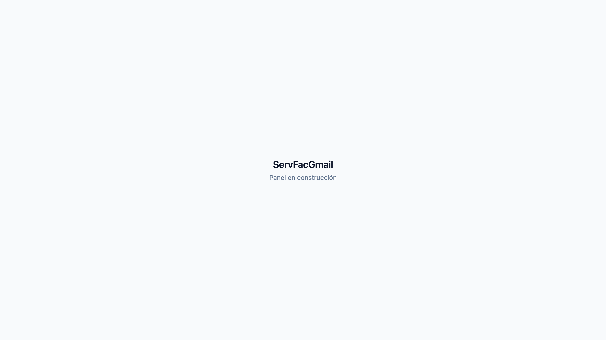

**Verificación**: pruebas, lint y build en verde; la API acepta el origen `http://localhost:5173`, incluida la cabecera `x-api-key` en el preflight de CORS.

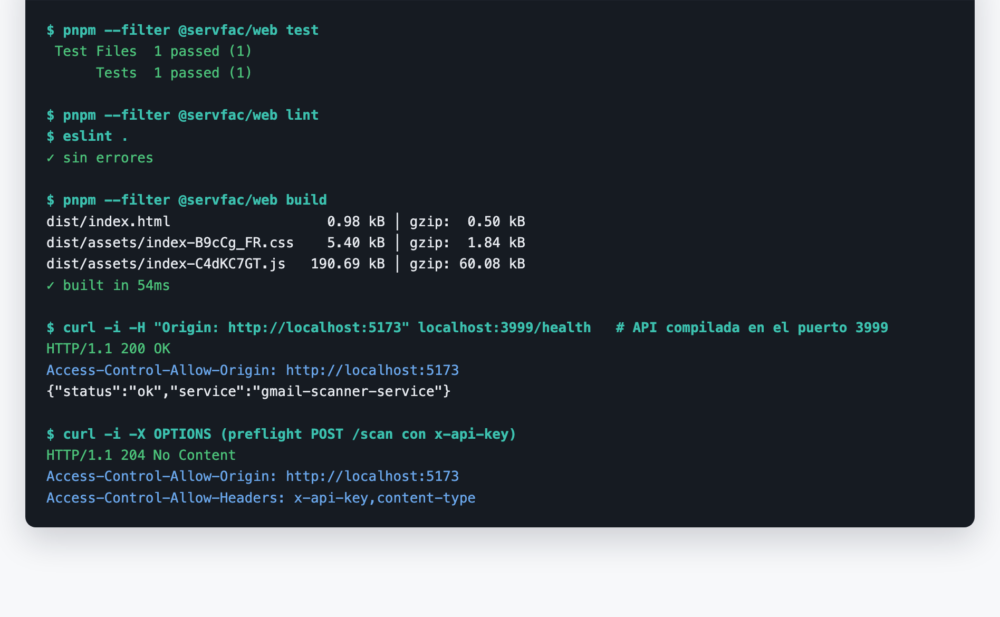

### Fase 1 — Fundaciones

Tokens del sistema de diseño (`src/assets/css/tokens.css`, claro y oscuro), estilos base y el kit de componentes: botones, inputs, lista de correos con chips, badges, avisos con detalle técnico, toasts, diálogos y drawer con trampa de foco, tabla de datos con orden y estados, tarjetas de resumen y el armazón de la app (barra superior, navegación lateral y zona de Administración).

Todos los componentes se ven en **`/_kit`** con `pnpm dev:web` (la ruta solo existe en desarrollo).

| Claro | Oscuro |
|---|---|
| 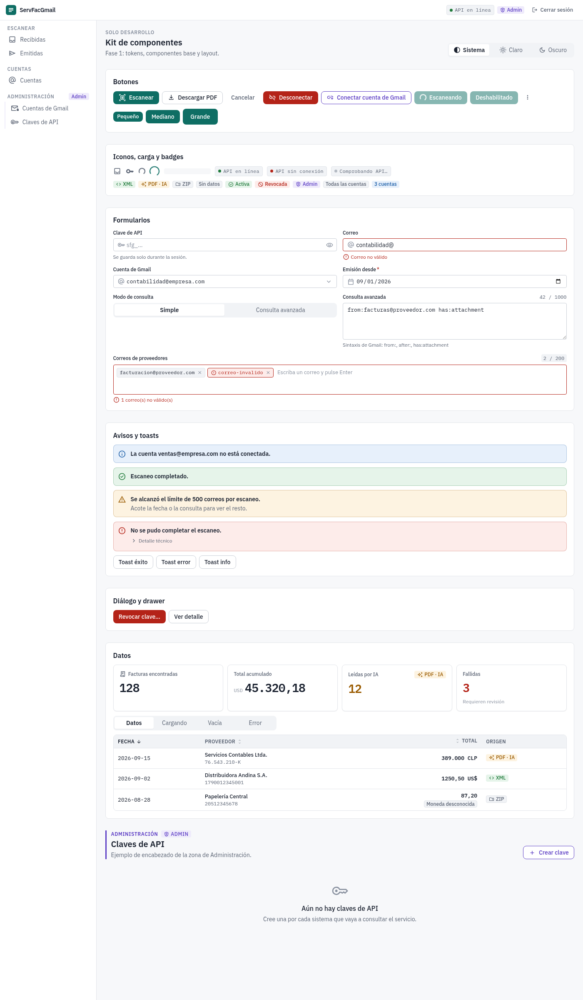 | 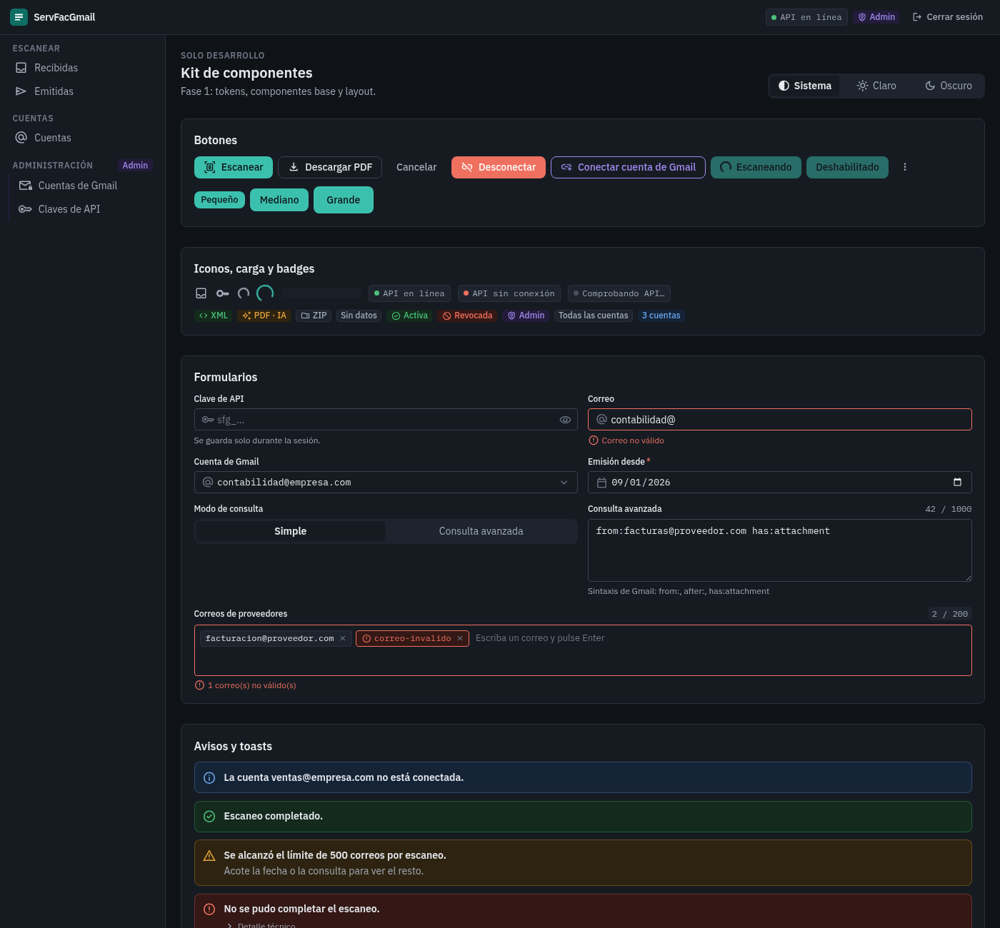 |

### Fase 2 — Sesión y acceso

Pantalla de Acceso con la clave de API (se guarda en `sessionStorage`). La clave se valida con `GET /accounts`, y el rol se detecta con `GET /admin/api-keys`: la clave maestra ve Administración y las de cliente no. Un `401` durante la sesión la cierra y vuelve a Acceso; un `503` lleva a «Servicio no disponible». La barra superior consulta `GET /health` cada 60 s. Todos los errores de la API llegan a la UI con el formato `{ status, userMessage, technicalError }`.

| Escritorio | Móvil (oscuro) |
|---|---|
| 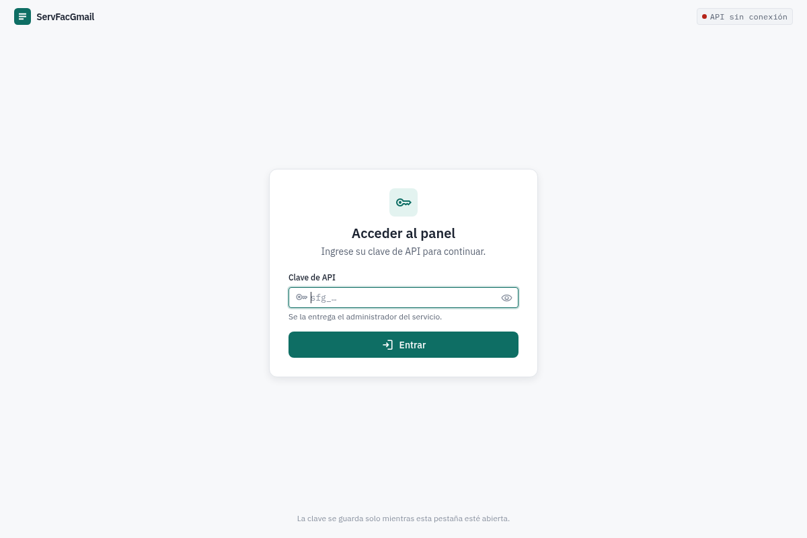 | 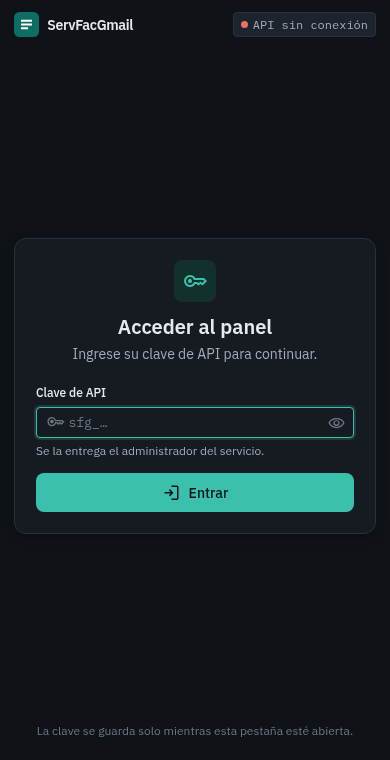 |

### Fase 3 — Cuentas de Gmail

Pantalla de Cuentas (`/cuentas` y, para administradores, `/admin/cuentas`) con fecha de conexión y última actualización del token. Selector de la cuenta activa en la barra superior. El administrador conecta cuentas desde la UI: se abre la ventana de Google y la lista se actualiza sola al terminar el consentimiento. Para desconectar una cuenta hay que escribir su correo como confirmación.

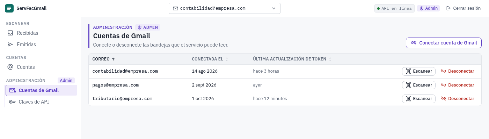

### Fase 4 — Escaneo de facturas

Pantallas **Recibidas** (`POST /scan`) y **Emitidas** (`POST /scan-sent`). Admiten dos modos: Simple (fecha + correos, o la lista por defecto del servidor) y Consulta avanzada (sintaxis de Gmail). La validación en el cliente es la misma que aplica la API. Mientras se escanea, se muestra el progreso con el tiempo transcurrido y la opción de cancelar. Al terminar aparecen:

- un resumen con el total por moneda, las facturas leídas por IA y las fallidas;
- un aviso si se alcanzó el límite de 500 correos;
- la tabla con búsqueda, filtro por origen (XML / PDF · IA) y exportación a CSV;
- la lista de adjuntos que no se pudieron leer.

Cada pestaña conserva sus resultados al cambiar de una a otra.

| Resultados | Escaneo en curso |
|---|---|
| 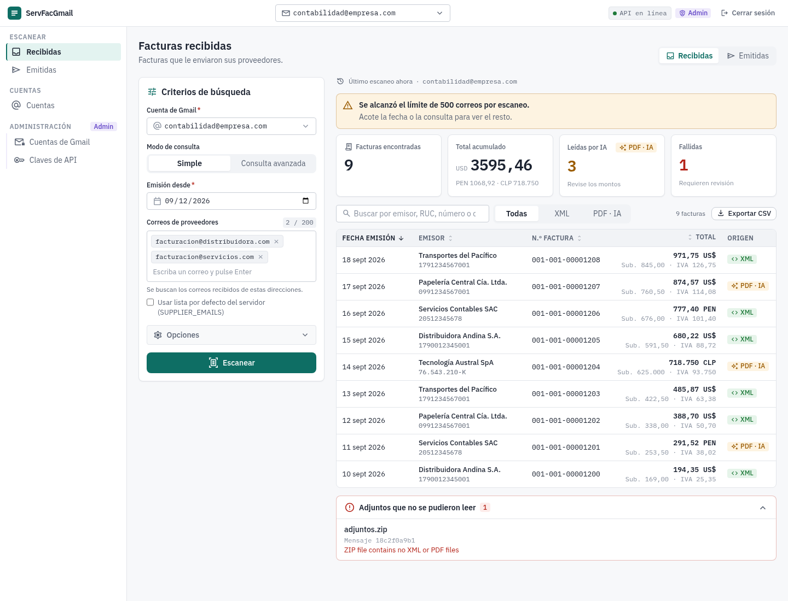 | 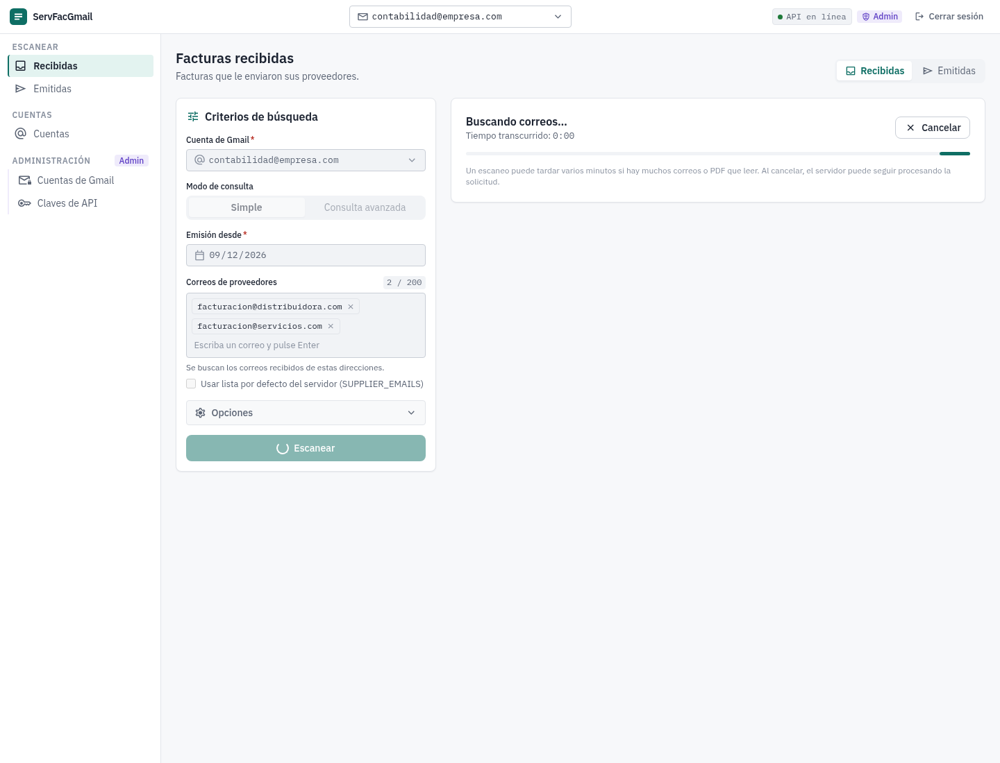 |

### Fase 5 — Detalle de factura y descarga

Al hacer clic en una factura se abre un panel lateral con:

- el emisor;
- el documento, con la clave de acceso copiable;
- el correo de origen;
- los ítems, con su suma y un aviso si no cuadran con el subtotal;
- la vista previa del PDF, que se carga solo al pedirla.

«Descargar PDF» está tanto en el panel como en cada fila de la tabla. Si el adjunto es un ZIP, la API extrae el PDF de dentro; si la factura se leyó de un XML, busca el PDF del mismo correo. Por seguridad, solo se muestra el archivo si es un PDF válido.

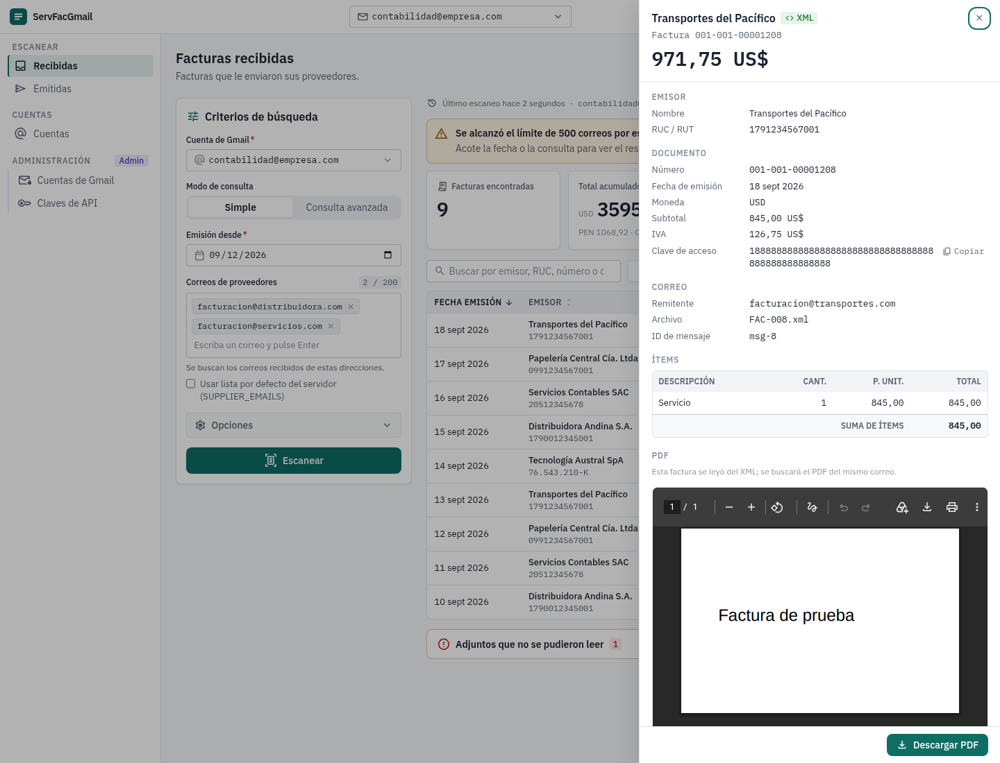

### Diseños de referencia (Google Stitch)

Pantallas exportadas a [`design/stitch/`](./design/stitch/) que se integrarán en las próximas fases. Algunos elementos que Stitch añadió no tienen respaldo en la API y no se implementarán: ver [`design/stitch/README.md`](./design/stitch/README.md).

| Acceso — Fase 2 | Escanear facturas recibidas — Fase 4 |
|---|---|
| 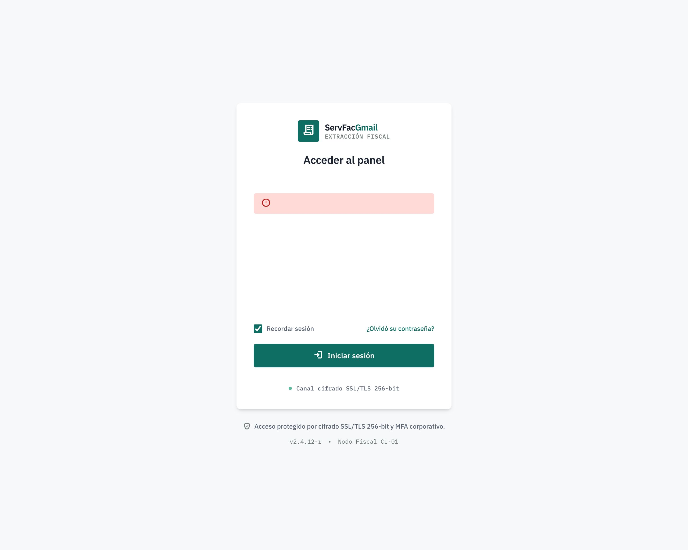 | 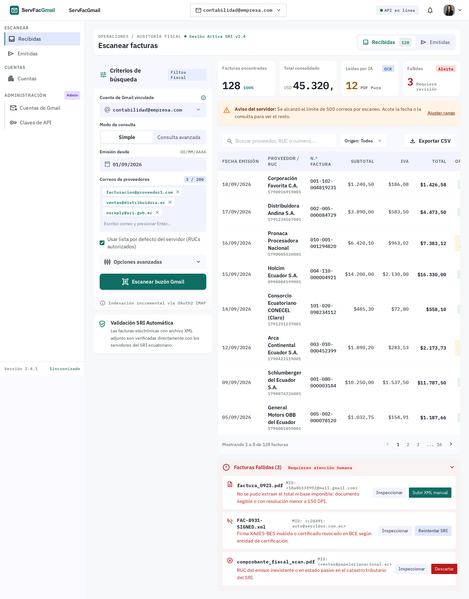 |

| Cuentas de Gmail — Fase 3 | Detalle de factura — Fase 5 |
|---|---|
| 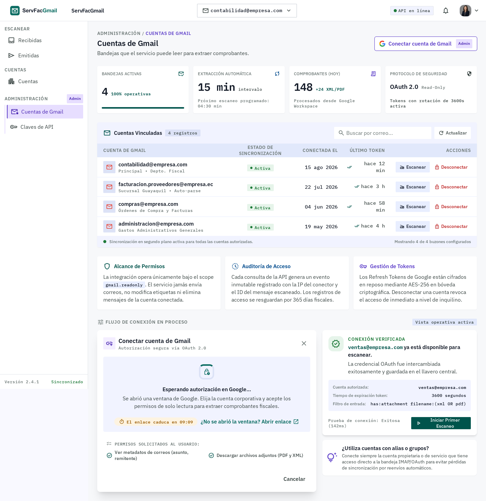 | 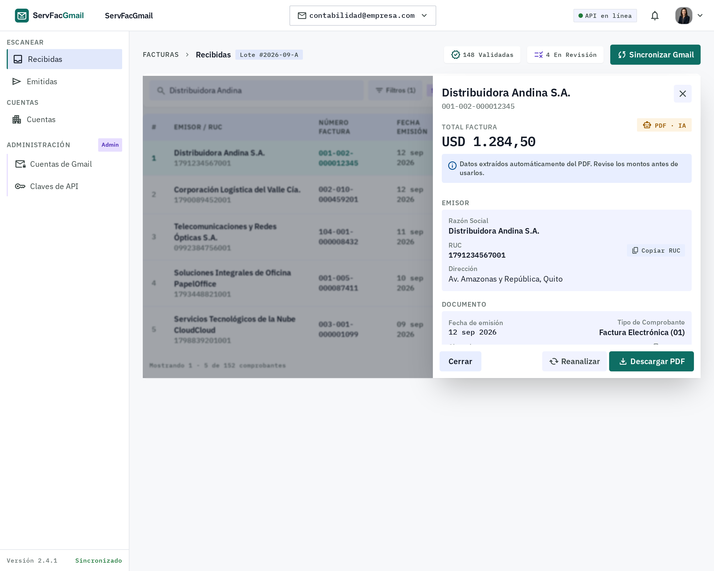 |

| Claves de API — Fase 6 |
|---|
| 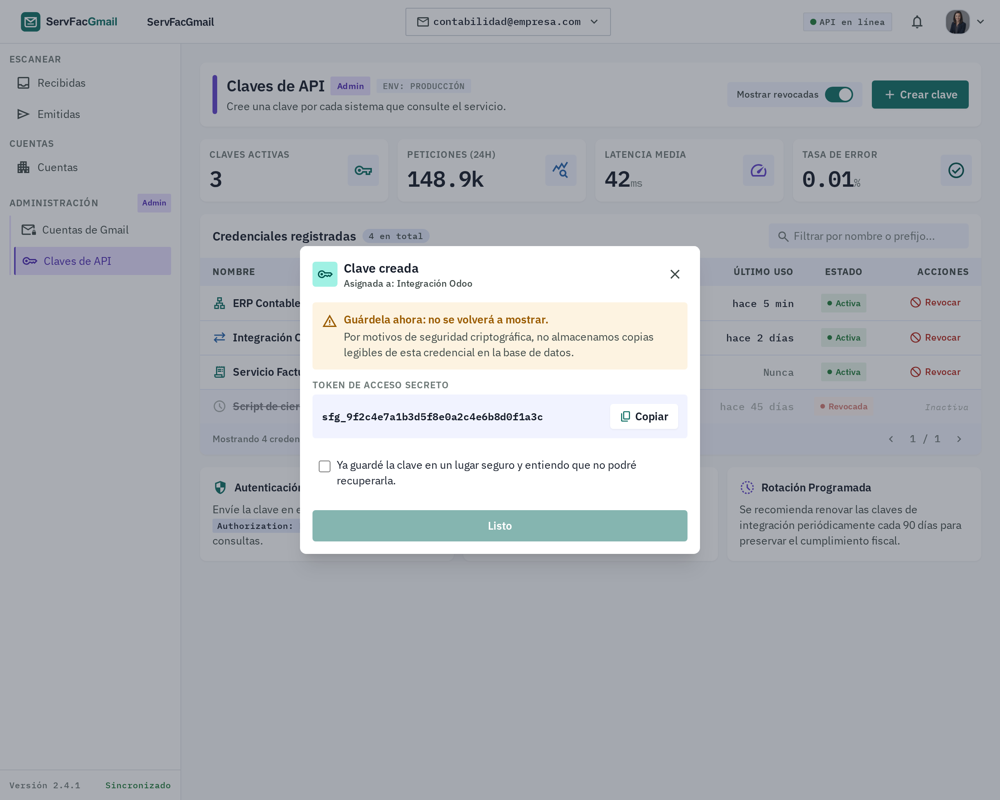 |
